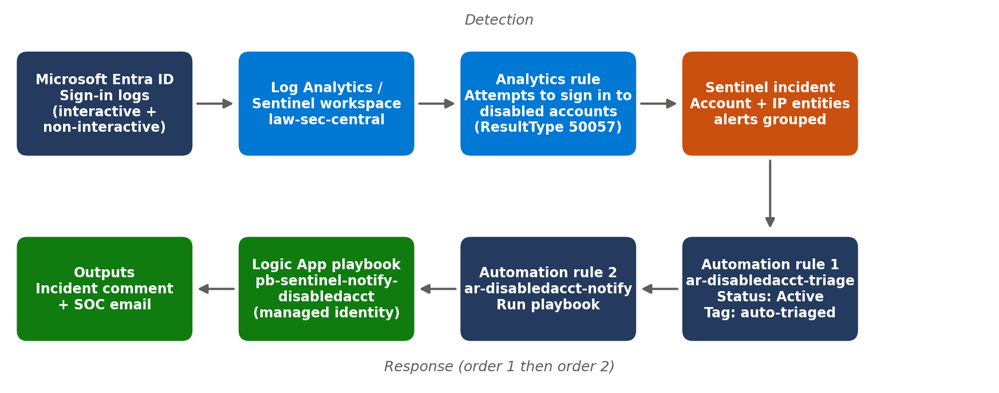
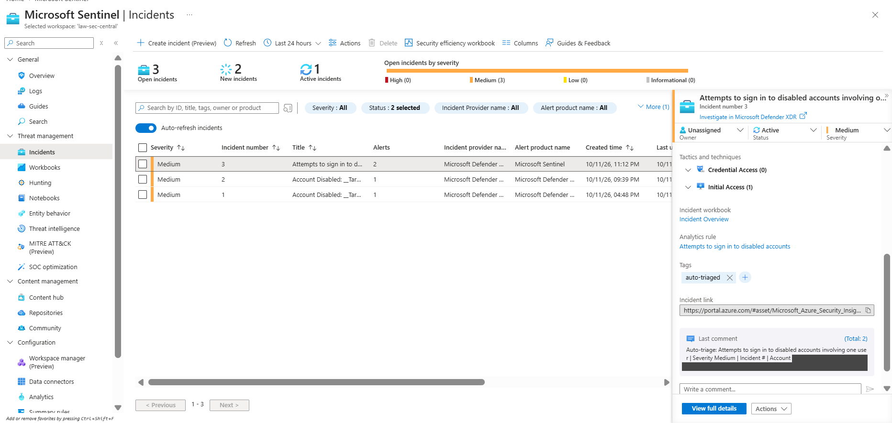
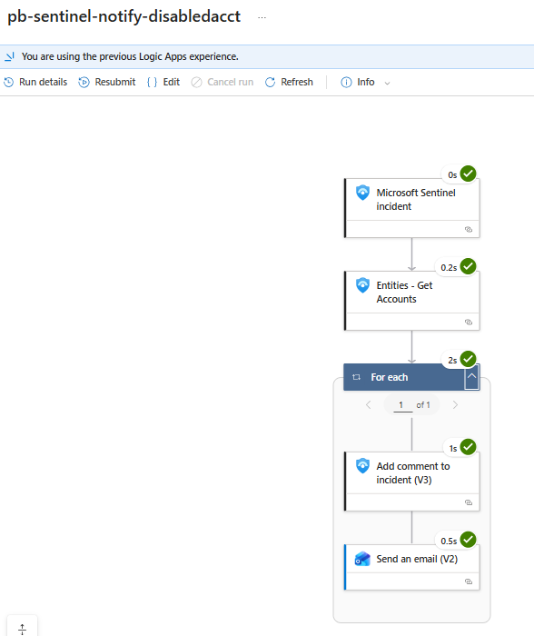
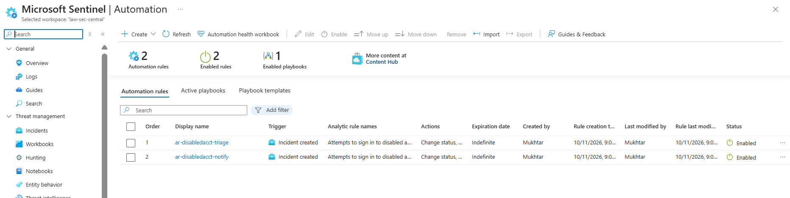
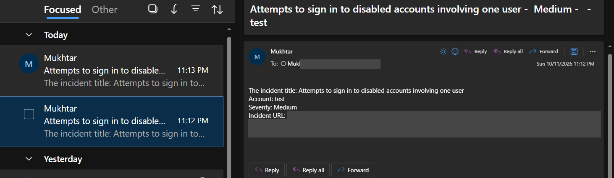

# Microsoft Sentinel: Disabled-Account Sign-in Incident Automation

End-to-end SOC response automation in **Microsoft Sentinel**. When someone tries to sign in with a **disabled** Entra ID account, Sentinel raises an incident, tags and activates it, and a **Logic App playbook** comments on the incident and emails the SOC. Nothing in the automation changes a user, a role or a device: it is triage and notification only.

> Project built in the Azure portal with a dedicated test account. No production data is included.

## What it does

1. **Detect**: a scheduled analytics rule looks for Entra error **50057** (user account is disabled) in `SigninLogs` and `AADNonInteractiveUserSignInLogs`, and maps **Account** and **IP** entities.
2. **Triage** (automation rule, order 1): sets the incident to *Active* and adds the tag `auto-triaged`.
3. **Notify** (automation rule, order 2): runs the playbook `pb-sentinel-notify-disabledacct`.
4. **Respond** (playbook): gets the accounts from the incident entities, adds an incident comment and sends an email with the title, account, severity and incident link.

## Repository layout

| Path | Contents |
|------|----------|
| `docs/Ticket-8B-Report.docx` | Full report: walkthrough, acceptance criteria, observations, risk register |
| `docs/images/` | Redacted screenshots used in the report and this README |
| `kql/` | Analytics rule query and a verification query |
| `playbook/` | Playbook design, permissions and automation rule settings |
| `terraform/` | Reference Terraform | 

## Key settings

| Item | Value |
|------|-------|
| Workspace / resource group | `law-sec-central` / `rg-infra-sec` (East US) |
| Rule | Template "Attempts to sign in to disabled accounts", severity Medium, tactics Initial Access and Credential Access, T1078 |
| Schedule | Every 5 minutes, lookback 5 hours, alert when results > 0, group events into a single alert |
| Threshold | 1 distinct app in the lab (template default 3) |
| Playbook identity | System-assigned managed identity |
| Roles | *Microsoft Sentinel Responder* (playbook identity) and *Microsoft Sentinel Automation Contributor* (Azure Security Insights), both on the resource group |

## Results

The test used a disabled account. The rule fired, incident #3 was created, tagged `auto-triaged`, set to Active, and commented on by the playbook; the email arrived and all playbook runs succeeded.

| Incident | Playbook run |
|----------|--------------|
|  |  |

| Automation rules (order 1 then 2) | Notification email |
|-----------------------------------|--------------------|
|  |  |

## Design decisions

- **Managed identity**, no stored credentials. Two role assignments with two purposes: the playbook identity needs *Responder* to comment; the Sentinel service needs *Automation Contributor* on the playbook's resource group, otherwise the playbook is not selectable in an automation rule.
- **Ordered automation rules**: triage first, so the playbook sees a tagged, active incident. Rules are scoped by analytics rule name so they do not touch incidents from other detections.
- **No auto-close and no identity changes**: wrong automation can hide a real attack.
- **Entity mapping** (Account + IP) so the playbook and analysts can pivot.

## Observations and follow-ups

- The incident number is empty in the comment and email because the *Merged Incident Number* token was used; the *Incident number* token is the fix.
- The 5-minute schedule with a 5-hour lookback re-reads the same events (incident #3 collected 6 alerts). Production: lookback near the schedule (for example 1 hour) and suppression if repeats continue.
- Lab shortcuts: hard-coded recipients and a personal Outlook connection. Production: shared SOC mailbox or Teams webhook, and one email per incident instead of one per account.
- Threshold 1 is for the lab; use the template default of 3 (or tune it) in production.

## Terraform status

`terraform/` holds a reference for the playbook shell, role assignments and automation rules. Check resource arguments against your `azurerm` provider version before use.

## Credits

The detection query is based on Microsoft's Sentinel content template "Attempts to sign in to disabled accounts" (see the Azure-Sentinel repository), adjusted for this lab.

## License

MIT. See `LICENSE`.
